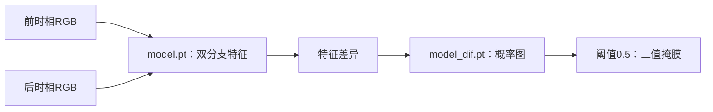

<div align="center">

# 遥感影像解译平台

### Remote Sensing Interpretation Platform · v1

面向高分二号卫星数据的预处理与遥感影像变化检测桌面平台


[项目介绍](#overview) · [功能状态](#features) · [环境配置](#environment) · [编译运行](#quick-start) · [使用说明](#usage) · [后续计划](#roadmap)

</div>

---

<a id="overview"></a>

## 项目介绍

本项目基于Qt/C++构建遥感影像解译桌面平台，面向高分二号（GF-2）卫星原始数据的预处理需求，并通过LibTorch集成深度学习模型推理，提供影像加载、结果展示与变化检测结果保存等交互能力。

v1已完成辐射定标与大气校正等预处理工作，暂不包含正射校正与全色—多光谱影像融合。变化检测模块采用RGB图像作为推理输入。项目将持续更新，逐步完善算法接入、数据处理流程和桌面端功能。


### 技术组成

- Qt Widgets负责桌面界面、图像加载、结果显示和文件保存。
- C++17负责应用逻辑、图像数据转换和推理调用。
- PyTorch用于模型开发与导出，项目给定的开发版本为1.13.1。
- LibTorch负责在C++应用中加载并执行TorchScript模型。
- CMake负责Qt与LibTorch依赖查找及工程构建。

<a id="features"></a>

## 功能状态

| 功能 | v1范围与当前代码状态 |
| :--- | :--- |
| GF-2辐射定标 | v1预处理工作已完成；当前快照的Qt入口待接入，算法文件尚未包含 |
| GF-2大气校正 | v1预处理工作已完成；当前快照的Qt入口待接入，算法文件尚未包含 |
| 影像加载与显示 | 已实现普通图像加载和按界面尺寸显示 |
| RGB影像变化检测 | 已接入双图加载、模型调用、二值结果展示与保存；需完成首次构建前的源码调整 |
| 正射校正 | v1暂不包含，界面预留入口 |
| 全色—多光谱影像融合 | v1暂不包含，界面预留入口 |
| 独立二值/语义变化检测入口 | 已预留菜单，当前槽函数为空 |
| 目标检测、云雾检测与去除、分类、道路提取 | 已预留菜单，当前槽函数为空 |

当前实际调用推理对话框的菜单为“变化检测→多模态变化检测”。该入口目前读取RGB图像，并输出二值变化掩膜；其他变化检测菜单尚未接入具体任务。

<a id="environment"></a>

## 环境配置

### 开发基线

| 组件 | 版本或要求 | 用途 |
| :--- | :--- | :--- |
| 操作系统 | Linux x86_64 | 当前工程配置与已有构建产物的平台 |
| Qt | 5.14.2，Desktop GCC 64-bit | 桌面界面；需包含Widgets与LinguistTools组件 |
| Qt Creator | 4.11.1，或兼容Qt5.14.2的版本 | 可选IDE；当前项目配置使用4.11.1 |
| C++ | C++17 | 工程采用的语言标准 |
| GCC/G++ | 参考编译器系列为GCC9 | 当前构建记录包含GCC9工具链路径 |
| CMake | 建议3.16及以上 | 原构建记录使用3.16.3；以下命令按此基线编写 |
| PyTorch | 1.13.1 | 模型开发与导出基线，Python端可选 |
| LibTorch | 建议与模型导出环境一致，优先核验1.13.1 | C++推理运行依赖 |
| Python | 建议3.10，仅模型检查或导出时需要 | Qt可执行程序本身不以Python脚本启动 |

当前构建产物链接的是LibTorch CPU库，建议首先使用CPU版本复现。GPU推理需要另行接入模型与张量的设备迁移。

> `pip install torch`安装的是Python包。C++工程还需要可供CMake查找的LibTorch头文件、库文件和配置文件。本文采用独立LibTorch发行包配置C++环境。

### 安装准备

以下安装与编译步骤以Linux桌面环境为例。Ubuntu/Debian可先准备基础工具：

```bash
sudo apt-get update
sudo apt-get install -y build-essential cmake unzip wget
```

从[Qt5.14.2官方归档](https://download.qt.io/archive/qt/5.14/5.14.2/)安装Qt，选择Desktop GCC 64-bit套件，并确认Widgets和LinguistTools组件可用。后续命令中的Qt路径需替换为本机实际安装目录。

Linux x86_64的LibTorch1.13.1 CPU、C++11 ABI发行包可按以下方式准备：

```bash
mkdir -p "$HOME/rsip-deps"

wget -O "$HOME/rsip-deps/libtorch-1.13.1-cpu.zip" \
  'https://download.pytorch.org/libtorch/cpu/libtorch-cxx11-abi-shared-with-deps-1.13.1%2Bcpu.zip'

unzip -q "$HOME/rsip-deps/libtorch-1.13.1-cpu.zip" \
  -d "$HOME/rsip-deps"
```

该命令使用独立依赖目录。已有LibTorch环境的用户可直接复用本机安装，并调整下文的`RSIP_TORCH_ROOT`。当前构建记录采用`_GLIBCXX_USE_CXX11_ABI=1`，应保持LibTorch与工程的ABI一致。

<a id="quick-start"></a>

## 编译运行

下载仓库或解压源码，进入包含`remote_image_process/`的仓库根目录。以下步骤从该目录开始执行。

### 1. 首次构建前的源码检查

当前快照中有两处影响推理与结果保存的代码需要调整。已完成这些修改的版本可直接进入下一步。

#### 补齐双时相模型输入

随仓库提供的`model.pt`具有`forward(x1, x2)`接口，但`remote_image_process/cd.cpp`中第二幅图的输入被注释。将特征提取部分调整为：

```cpp
std::vector<torch::jit::IValue> inputs;
inputs.push_back(t1);
inputs.push_back(t2);
auto output = module.forward(inputs).toTuple();
```

#### 让结果图像持有独立内存

同一函数中的`QImage`直接引用局部Tensor的内存。替换原有的结果图像构造代码，校验尺寸并复制数据，保证检测函数返回后仍可保存图像：

```cpp
binary = binary.contiguous();

if (binary.dim() != 2 ||
    binary.size(0) != origH ||
    binary.size(1) != origW) {
    QMessageBox::critical(this, "错误", "模型输出尺寸与输入图像不一致。");
    return;
}

resultImg = QImage(
    binary.data_ptr<uchar>(),
    origW,
    origH,
    static_cast<int>(binary.stride(0)),
    QImage::Format_Grayscale8
).copy();
```

以上为当前快照的最小调整。更换模型时，还需核验模型版本、输入尺寸和输出接口。

### 2. 配置依赖路径

在仓库根目录的同一终端中执行，并根据本机安装位置修改前两行：

```bash
RSIP_QT_ROOT="$HOME/Qt5.14.2/5.14.2/gcc_64"
RSIP_TORCH_ROOT="$HOME/rsip-deps/libtorch"
RSIP_REPO_ROOT="$PWD"

test -f "$RSIP_QT_ROOT/lib/cmake/Qt5/Qt5Config.cmake"
test -f "$RSIP_TORCH_ROOT/share/cmake/Torch/TorchConfig.cmake"
```

两条`test`命令应均返回成功；若返回非零状态，请先检查对应路径。

### 3. 使用CMake构建

创建新的`build-local/`目录进行构建，避免原构建缓存中的本机绝对路径影响配置：

```bash
cmake -S "$RSIP_REPO_ROOT/remote_image_process" \
  -B "$RSIP_REPO_ROOT/build-local" \
  -DCMAKE_BUILD_TYPE=Release \
  -DCMAKE_PREFIX_PATH="$RSIP_QT_ROOT;$RSIP_TORCH_ROOT" \
  -DTorch_DIR="$RSIP_TORCH_ROOT/share/cmake/Torch" \
  -DCMAKE_CXX_FLAGS="-D_GLIBCXX_USE_CXX11_ABI=1"

cmake --build "$RSIP_REPO_ROOT/build-local" --parallel 2
```

这里的ABI参数与上文下载的C++11 ABI版本对应。使用其他LibTorch发行包时，应同步调整ABI配置，避免混用。

### 4. 放置模型文件

当前快照将两个模型文件放在原Debug构建目录中。复制到新构建目录：

```bash
RSIP_MODEL_SOURCE="$RSIP_REPO_ROOT/build-remote_image_process-Desktop_Qt_5_14_2_GCC_64bit-Debug"

cp "$RSIP_MODEL_SOURCE/model.pt" \
  "$RSIP_REPO_ROOT/build-local/model.pt"

cp "$RSIP_MODEL_SOURCE/model_dif.pt" \
  "$RSIP_REPO_ROOT/build-local/model_dif.pt"
```

模型加载使用相对路径`model.pt`和`model_dif.pt`，因此文件必须位于程序的工作目录中。

### 5. 启动程序

```bash
cd "$RSIP_REPO_ROOT/build-local"

LD_LIBRARY_PATH="$RSIP_QT_ROOT/lib:$RSIP_TORCH_ROOT/lib${LD_LIBRARY_PATH:+:$LD_LIBRARY_PATH}" \
  ./remote_image_process
```

程序需要可用的桌面显示环境。启动成功后将打开主窗口，再按下文加载两幅RGB图像执行检测。

### 使用Qt Creator

也可在Qt Creator中打开`remote_image_process/CMakeLists.txt`：

1. 选择Desktop Qt5.14.2 GCC 64-bit套件。
2. 指定新的构建目录，并将Qt和LibTorch安装路径加入`CMAKE_PREFIX_PATH`。
3. 检查LibTorch的ABI配置与编译器设置是否一致。
4. 完成上述两处源码调整，构建工程。
5. 将`model.pt`与`model_dif.pt`放入运行工作目录，并在运行设置中确认该目录。

仓库中的`CMakeLists.txt.user`包含原开发机的配置；首次打开时应重新选择本机套件和目录。

<a id="usage"></a>

## 使用说明

### 数据准备

预处理任务与变化检测推理使用不同阶段的数据：

| 场景 | 输入要求 |
| :--- | :--- |
| GF-2预处理 | 高分二号卫星原始影像，以及与该产品匹配的元数据、定标参数和大气校正参数；本快照未公开具体算法调用方式 |
| 变化检测推理 | 两幅三通道RGB图像，空间范围一致、像素已对应、宽高相同，并符合所用模型的训练与导出要求 |

变化检测入口通过Qt加载普通图像，程序内部转换为`RGB888`，再转换为`float32`的`[1, 3, H, W]`张量，像素值除以255后进入模型。

- 建议使用PNG或JPG格式的RGB图像，优先采用PNG保留像素值。
- 两个时相应完成必要的配准、裁剪与尺寸统一；当前推理流程不自动完成这些操作。
- 多光谱原始数据应先按模型训练时的波段选择、通道顺序与拉伸方式生成RGB输入。
- 当前入口不提供多波段GeoTIFF的专门读取与地理信息解析，也不在推理前自动执行辐射定标或大气校正。
- 图像仅在界面显示时按比例缩放，推理使用原图尺寸；大幅影像宜先裁剪，当前未接入分块推理。

### 执行变化检测

1. 启动程序，选择“变化检测→多模态变化检测”。
2. 点击“打开”，依次选择前时相图像和后时相图像。
3. 检查两幅输入是否对应同一区域，并确认尺寸一致。
4. 点击“检测”，程序加载两个TorchScript模型并生成二值结果。
5. 点击“保存”，选择输出位置，建议保存为PNG。

当前代码采用固定阈值`0.5`：大于阈值的像素显示为白色（255），其余像素显示为黑色（0）。白色表示模型预测的变化区域，黑色表示预测的未变化区域。

输出为普通图像格式的二值掩膜。当前保存流程不附带坐标系、仿射变换或其他GIS元数据。

### 推理数据流



特征差异按逐元素方式计算`√((F1−F2)²+10⁻¹⁵)`，随后送入变化判别模型。

<a id="models"></a>

## 模型部署

| 模型文件 | 当前接口 | 作用 |
| :--- | :--- | :--- |
| `model.pt` | `forward(x1, x2)`返回四个Tensor组成的元组；C++端使用前两个 | 提取两幅输入图像的特征 |
| `model_dif.pt` | `forward(diff_feature)`返回Tensor | 将特征差异转换为变化概率图 |

模型文件需为可由`torch::jit::load()`加载的TorchScript文件。仅修改普通权重文件的扩展名，不能使其满足该接口。

替换模型时，应保持以下约定：

- 输入通道为RGB顺序，张量布局为`NCHW`，数值范围为`[0, 1]`。
- 特征模型接收两幅图像，返回的前两个Tensor可进行逐元素相减。
- 变化判别模型接收上述差异张量，输出可还原为二维概率图。
- 概率图尺寸与输入尺寸一致，或在C++端显式完成尺寸恢复。
- 导出设备、算子和模型文件格式与所用LibTorch兼容。

PyTorch1.13.1为项目给定的开发基线；随包模型的实际导出版本需在对应运行环境中核验。遇到模型文件版本或算子不兼容时，应使用匹配环境重新导出，或同步调整LibTorch。

<details>
<summary>可选：使用Python检查模型接口与输出尺寸</summary>

此步骤在仓库根目录执行，使用Python3.10建立独立环境。运行Qt应用时不需要激活此环境。

```bash
python3.10 -m venv .venv-model-check
source .venv-model-check/bin/activate

python -m pip install 'torch==1.13.1+cpu' \
  --extra-index-url https://download.pytorch.org/whl/cpu

python - <<'PY'
from pathlib import Path
import torch

model_dir = Path('build-remote_image_process-Desktop_Qt_5_14_2_GCC_64bit-Debug')
encoder = torch.jit.load(str(model_dir / 'model.pt'), map_location='cpu').eval()
head = torch.jit.load(str(model_dir / 'model_dif.pt'), map_location='cpu').eval()

print('PyTorch:', torch.__version__)
print('Feature model:', encoder.forward.schema)
print('Change model:', head.forward.schema)

x1 = torch.rand(1, 3, 256, 256)
x2 = torch.rand(1, 3, 256, 256)

with torch.no_grad():
    outputs = encoder(x1, x2)
    f1, f2 = outputs[0], outputs[1]
    diff = torch.sqrt((f1 - f2).pow(2) + 1e-15)
    prob = head(diff).squeeze()

print('Features:', tuple(f1.shape), tuple(f2.shape))
print('Probability map:', tuple(prob.shape))
assert tuple(prob.shape) == (256, 256), 'Output size does not match input size.'
PY
```

`256×256`为检查用示例尺寸。此检查用于确认文件能否加载、双输入接口和输出尺寸，不代表真实影像上的检测精度。

</details>

<a id="structure"></a>

## 仓库结构

| 路径 | 内容 |
| :--- | :--- |
| `README.md` | 项目说明、环境配置与使用方法 |
| `remote_image_process/CMakeLists.txt` | Qt/C++与LibTorch构建配置 |
| `remote_image_process/main.cpp` | 应用入口 |
| `remote_image_process/mainwindow.{h,cpp,ui}` | 主窗口、菜单入口与影像展示 |
| `remote_image_process/cd.{h,cpp,ui}` | 双图加载、变化检测与结果保存 |
| `remote_image_process/remote_image_process_zh_CN.ts` | Qt翻译源文件 |
| `remote_image_process/CMakeLists.txt.user` | 原开发机的Qt Creator配置 |
| `build-remote_image_process-Desktop_Qt_5_14_2_GCC_64bit-Debug/` | 当前随包提供的原构建目录，包含两个模型和Linux可执行文件 |
| `build-local/` | 按本文步骤生成的本机构建目录 |

原构建目录中的缓存和可执行文件依赖原开发环境。新环境建议从源码重新构建；后续发布可将模型迁移至独立目录，便于维护和部署。

<a id="faq"></a>

## 常见问题

| 问题或现象 | 检查与处理 |
| :--- | :--- |
| 找不到`Qt5Config.cmake` | 检查Qt安装目录与`CMAKE_PREFIX_PATH`，确认使用Desktop GCC 64-bit套件 |
| 找不到`Qt5LinguistTools` | 安装对应Qt版本的LinguistTools组件，避免混用不同Qt安装中的组件 |
| 找不到`TorchConfig.cmake` | 检查`RSIP_TORCH_ROOT/share/cmake/Torch/`，将`Torch_DIR`指向该目录 |
| 链接阶段出现`undefined reference` | 检查LibTorch版本、编译器与`_GLIBCXX_USE_CXX11_ABI`是否匹配 |
| 启动时缺少`libtorch.so`或`libc10.so` | 按启动命令配置LibTorch的动态库路径 |
| 无法加载Qt平台插件`xcb` | 检查桌面显示环境、Qt插件路径及插件依赖，优先使用与构建版本一致的Qt安装 |
| 提示模型加载失败 | 确认两个模型位于运行工作目录，文件名称与格式正确，并核验导出版本兼容性 |
| 检测时提示缺少模型参数 | 确认已恢复`inputs.push_back(t2)`，并重新编译应用 |
| 输出尺寸与输入不一致 | 核验模型在目标尺寸上的输出；更换模型时需显式恢复到输入尺寸 |
| 保存结果异常或图像损坏 | 确认结果图像构造已调用`.copy()`，并检查输出目录写入权限 |
| 点击预处理或其他菜单无响应 | 查阅功能表；当前快照中对应槽函数可能仍为空 |
| 大图推理耗时较长，界面暂时无响应 | 当前检测在界面线程中执行；先使用小范围影像，后续计划接入工作线程与分块推理 |

<a id="roadmap"></a>

## 后续计划

- [ ] 补充GF-2辐射定标、大气校正的算法文件、参数说明与示例，并完善GUI接入。
- [ ] 完善双时相输入校验、推理异常提示和模型管理。
- [ ] 将推理任务迁移至工作线程，完善进度反馈与交互体验。
- [ ] 增加大幅影像分块推理与结果拼接。
- [ ] 逐步完善正射校正、全色—多光谱影像融合等处理能力。
- [ ] 扩展变化检测及其他遥感解译任务。
- [ ] 完善示例数据、界面截图与可复现演示。
- [ ] 整理独立模型目录、依赖说明与发布包。

以上为后续开发方向，具体功能以对应版本的代码和发布说明为准。

## 交流与反馈

欢迎通过仓库Issues提交问题、建议和功能需求。报告问题时，请提供操作系统、Qt/LibTorch版本、复现步骤、报错信息及输入图像尺寸；涉及模型替换时，请附输入输出接口说明。

当前快照未附带`LICENSE`文件，项目许可说明待补充。Qt、PyTorch/LibTorch及其他第三方组件遵循各自的许可条款。

## 参考资料

- [Qt5.14.2官方归档](https://download.qt.io/archive/qt/5.14/5.14.2/)
- [PyTorch历史版本与安装命令](https://docs.pytorch.org/get-started/previous-versions/)
- [LibTorch官方安装与CMake配置说明](https://docs.pytorch.org/cppdocs/installing.html)
- [LibTorch CPU官方发行包索引](https://download.pytorch.org/libtorch/cpu/)

---

<div align="center">

持续更新中 · 从GF-2预处理到遥感影像解译

</div>
